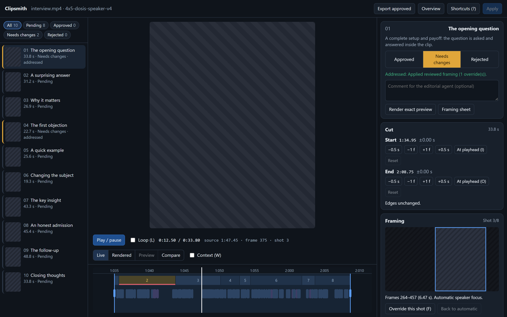

Turn long recordings into short, captioned vertical clips for Shorts, Reels and TikTok with an AI agent as your editor.

Simply drop your video into `Raw/`. Clipsmith finds the best 20–60 second moments, cuts them, optimizes framing and adds captions. Everything runs locally on your computer. No API key required.

## What you get

- **4:5 vertical clips** (1080×1350 by default) that follow whoever is speaking. Faces are tracked, and audiovisual speaker detection (Light-ASD) decides who is talking.
- **Word-by-word highlighted captions**, transcribed locally with Whisper.
- **Clean cuts** that never split a word or flash a few frames of the neighbouring camera shot, with loudness normalisation and soft audio fades.
- **A clip editor in your browser** to approve or reject clips, move edges, fix framing and correct caption words.

## Requirements

- [Python 3.12 or newer](https://www.python.org/downloads/) (tested with 3.13)
- [FFmpeg](https://ffmpeg.org/download.html), with `ffmpeg` and `ffprobe` on your PATH
- An AI coding agent that can run commands in this folder

The first run creates a local `.venv` and installs everything else. It also downloads the Whisper model once (about 1.5 GB). An NVIDIA GPU is optional: when `nvidia-smi` is available, the first run also installs the CUDA libraries for transcription (about 1.25 GB), and transcription and encoding run on the GPU.

## Quick start

1. Clone the repository and open the folder in your AI agent.

   ```bash
   git clone https://github.com/schyro/Clipsmith.git
   ```

2. Copy one or more recordings into the `Raw/` folder. Create the folder if it is not there.
3. Tell the agent: **"I added videos to Raw."**

The agent follows [AGENTS.md](AGENTS.md). It prepares transcripts, chooses the clips, renders them, checks the results and gives you the file paths. Finished clips are saved in `Output/<recording>/<profile>/`.

### Running it yourself

`run.cmd` (Windows) and `run.sh` (macOS/Linux) take the same options:

```bash
./run.cmd --prepare-review     # transcribe and build review material for the agent
./run.cmd --require-reviewed   # render clips from the agent's reviewed plans
./run.cmd --review-gallery     # open the clip editor
./run.cmd --apply-review       # apply your editor decisions
```

A plain `./run.cmd` with no options picks clips with a simple keyword heuristic. It is a rough fallback; the agent does a far better job.

## Reviewing clips



`./run.cmd --review-gallery` opens the editor in its own window (`http://127.0.0.1:8765/editor/`). For each clip you can:

- approve it, reject it or ask for changes, with a comment or notes pinned to moments on the timeline
- move the start and end (cuts snap to word boundaries)
- set the framing per camera shot
- fix, retime, add or re-transcribe caption words, choose where a caption line breaks, and find and replace words across the whole source
- step through flagged shots and low-confidence words, zoom the timeline with Ctrl + mouse wheel, and undo any edit

Press **Apply** to re-render the changed clips, or ask the agent to apply your review. The agent handles your comments and notes. **Export approved** copies the approved clips to a `ready/` folder.

Full guide: [docs/clip-editor.md](docs/clip-editor.md).

## Settings

Output size, caption font, size, position and colour, fades and speaker-switch timing are set in [video_settings.json](video_settings.json). Change the `profile` name when you change settings, so earlier exports are kept. The agent treats this file as your preference.

## Learn more

- [docs/framing.md](docs/framing.md): how speaker framing works, and the plan file format
- [docs/clip-editor.md](docs/clip-editor.md): the editor and the review decisions file
- [docs/reference.md](docs/reference.md): all commands, caption corrections, caching and tests
- [examples/plan.example.json](examples/plan.example.json): an example clip plan

## Privacy

Videos never leave your machine: transcription, face tracking and rendering all run locally. Your own recordings, plans and outputs (`Raw/`, `Plans/`, `Output/`, `Review/`, `work/`) are git-ignored.

## License and credits

Clipsmith is released under the [MIT License](LICENSE). It bundles or uses:

- [Light-ASD](https://github.com/Junhua-Liao/Light-ASD) (MIT), in `third_party/light_asd`; see `PROVENANCE.md` there
- [OpenCV YuNet](https://github.com/opencv/opencv_zoo/tree/main/models/face_detection_yunet) face detector; licence in `assets/licenses/LICENSE-YuNet.txt`
- [Dosis](https://github.com/google/fonts/tree/main/ofl/dosis) font (SIL OFL); licence in `assets/licenses/OFL-Dosis.txt`
- [IBM Plex Sans and IBM Plex Mono](https://github.com/google/fonts/tree/main/ofl/ibmplexsans) fonts for the clip editor (SIL OFL); licence in `assets/licenses/OFL-IBM-Plex.txt`
- [faster-whisper](https://github.com/SYSTRAN/faster-whisper), [FFmpeg](https://ffmpeg.org/), and [Preact](https://preactjs.com/) with [htm](https://github.com/developit/htm) (vendored in `editor/vendor/`)
